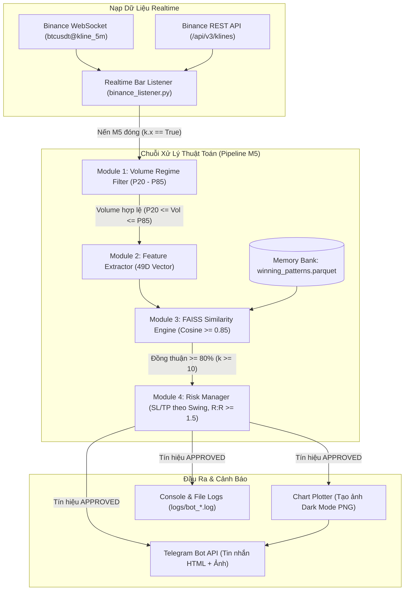

# BINANCE PATTERN-MATCHING SIGNAL BOT (M5)
## Hệ Thống Nhận Diện Mẫu Hình Ký Ức & Bắn Tín Hiệu Giao Dịch Tự Động (AI-Driven Signal Alert System)

[](https://www.python.org/)
[](https://github.com/facebookresearch/faiss)
[](https://binance.com)
[-brightgreen.svg)]()
[]()
[]()

---

## 1. TỔNG QUAN HỆ THỐNG (SYSTEM OVERVIEW)

**Signal_Trade** là hệ thống phần mềm phân tích kỹ thuật và phát tín hiệu tự động cho cặp giao dịch trên **Binance (mặc định BTC/USDT)** trên khung thời gian **M5 (5 phút)**. 

Khác với các hệ thống giao dịch dựa trên quy tắc chỉ báo cứng nhắc (RSI quá mua/quá bán, giao cắt MA) hay mô hình dự đoán hộp đen (Black-box Deep Learning dễ bị overfitting), **Signal_Trade** hoạt động dựa trên triết lý **Memory-Based Pattern Matching (So khớp mẫu hình dựa trên ký ức thị trường)**:
1. **Số hóa trạng thái thị trường:** Chuyển đổi chuỗi 15 nến setup gần nhất thành một Vector đặc trưng số học 49 chiều (độc lập với mức giá tuyệt đối).
2. **Tìm kiếm ký ức tương đồng tốc độ cao:** Sử dụng thuật toán tìm kiếm không gian vector **FAISS (Facebook AI Similarity Search)** với độ đo Cosine Similarity ($\ge 85\%$) so khớp với cơ sở dữ liệu các mẫu hình từng thắng lớn trong lịch sử.
3. **Bộ lọc đa tầng & Quản trị rủi ro:** Lọc bỏ các giai đoạn thanh khoản mỏng hoặc bão tin tức bằng **Volume Regime Filter ($P_{20} - P_{85}$)**; tự động tính mức Stop Loss linh hoạt theo **Swing Low / Swing High 15 nến**, Take Profit chuẩn tỷ lệ **$R:R \ge 1.5$** và quản lý rủi ro 1% vốn.
4. **Bắn tín hiệu trực quan:** Gửi bản tin phân tích HTML kèm **ảnh biểu đồ nến mini (Dark Mode Chart Snapshot)** trực tiếp về Telegram ngay khi nến M5 vừa đóng.

> [!NOTE]
> **Định vị hệ thống:** Đây là hệ thống **thuần phát tín hiệu (Signal-Only Alert)**. Hệ thống kết nối trực tiếp với **Binance Public API (REST & WebSocket)** hoàn toàn miễn phí, không yêu cầu API Key/Secret, không phụ thuộc vào MetaTrader 5, không can thiệp đặt lệnh tự động, an toàn tuyệt đối 100%.

---

## 2. KIẾN TRÚC VÀ CÁC MODULE CỐT LÕI



### Chi tiết các Module:
* **Module 1 - Volume Regime Filter ([`volume_filter.py`](file:///d:/DACNTT-1/Signal_Trade/src/features/volume_filter.py)):** Cửa sổ trượt 100 nến, tính phân vị $P_{20}$ và $P_{85}$. Loại bỏ nến có khối lượng $< P_{20}$ (thanh khoản mỏng, giãn spread) hoặc $> P_{85}$ (biến động cực đoan do tin tức kinh tế, quét râu).
* **Module 2 - Feature Engineering ([`extractor.py`](file:///d:/DACNTT-1/Signal_Trade/src/features/extractor.py)):** Trích xuất Vector 49 chiều gồm chuỗi giá chuẩn hóa ($\Delta Close, \Delta High, \Delta Low$ của 15 nến setup), chỉ báo vi mô RSI(7), Volume Z-Score(20), và ATR Ratio(14).
* **Module 3 - Offline Pattern Miner ([`pattern_miner.py`](file:///d:/DACNTT-1/Signal_Trade/src/mining/pattern_miner.py)):** Quét chuỗi nến lịch sử và gán nhãn theo phương pháp **Triple Barrier Method** (Take Profit $2.0 \times \text{ATR}$, Stop Loss $1.0 \times \text{ATR}$, giới hạn thời gian 12 nến / 60 phút). Lưu các mẫu hình chiến thắng thành cơ sở dữ liệu `winning_patterns.parquet`.
* **Module 4 - Similarity Engine ([`similarity_engine.py`](file:///d:/DACNTT-1/Signal_Trade/src/engine/similarity_engine.py)):** So khớp Cosine Similarity sử dụng chỉ mục `IndexFlatIP` của FAISS. Yêu cầu tối thiểu $k \ge 10$ mẫu tương đồng với độ tương đồng $\ge 85\%$ và tỷ lệ đồng thuận hướng đi $\ge 80\%$.
* **Module 5 - Risk Manager ([`risk_manager.py`](file:///d:/DACNTT-1/Signal_Trade/src/engine/risk_manager.py)):** Định giá Entry tại $Close_t$. Stop Loss đặt tại Swing Low (LONG) hoặc Swing High (SHORT) của 15 nến setup kèm vùng đệm $20 USD. Take Profit tính theo tỷ lệ $R:R \ge 1.5$. Tính khối lượng đề xuất theo nguyên tắc rủi ro 1% vốn.
* **Module 6 - Realtime Bar Listener ([`binance_listener.py`](file:///d:/DACNTT-1/Signal_Trade/src/execution/binance_listener.py)):** Lắng nghe sự kiện đóng nến M5 trực tiếp từ Binance WebSocket với độ trễ tính bằng mili-giây, tích hợp cơ chế Polling REST tự hồi phục và chống kích hoạt trùng lặp.
* **Module 7 - Alert & Visual Snapshot ([`telegram_bot.py`](file:///d:/DACNTT-1/Signal_Trade/src/execution/telegram_bot.py), [`chart_plotter.py`](file:///d:/DACNTT-1/Signal_Trade/src/execution/chart_plotter.py)):** Tạo ảnh biểu đồ kỹ thuật 15 nến setup có đường dóng Entry/SL/TP và gửi thông báo tức thời qua Telegram Bot API.

---

## 3. CẤU TRÚC THƯ MỤC DỰ ÁN (PROJECT STRUCTURE)

```
Signal_Trade/
├── config/
│   ├── .env.example              # Mẫu cấu hình biến môi trường (Telegram Bot Token, Chat ID)
│   └── config.yaml               # Cấu hình toàn bộ tham số thuật toán & đường dẫn
├── data/
│   ├── raw/
│   │   └── btcusdt_m5.parquet    # Dữ liệu nến lịch sử thật tải từ Binance (17,280 nến M5)
│   └── patterns/
│       └── winning_patterns.parquet # Cơ sở dữ liệu 1,977 mẫu hình chiến thắng trong quá khứ
├── logs/                         # File log hệ thống tự động xoay vòng theo ngày
├── plan/                         # Kế hoạch triển khai tổng thể & tài liệu chi tiết 11 Tasks
│   ├── README.md                 # Master Roadmap
│   └── task_01 -> task_11.md     # Tài liệu chi tiết từng task
├── reports/                      # Báo cáo kết quả kiểm thử Out-of-Sample (Backtest)
│   ├── backtest_trades.csv       # Nhật ký chi tiết 123 lệnh giao dịch kiểm thử
│   └── equity_curve.png          # Biểu đồ đường cong vốn trực quan
├── scripts/
│   ├── download_data.py          # Script tải dữ liệu nến lịch sử từ Binance REST API
│   ├── mine_patterns.py          # Script khai thác mẫu hình thắng (Offline Mining)
│   ├── run_backtest.py           # Script chạy kiểm thử độc lập (Out-of-Sample Backtest)
│   ├── run_bot.ps1               # Script PowerShell khởi chạy và bảo vệ tiến trình bot
│   └── run_listener_test.py      # Script thử nghiệm bắt nến Binance thời gian thực
├── src/
│   ├── core/                     # Cấu hình Pydantic & Data Transfer Objects (DTO)
│   │   ├── config_loader.py
│   │   └── schemas.py
│   ├── data/                     # Data loader từ Binance API & Parquet Storage
│   │   ├── binance_loader.py
│   │   ├── csv_loader.py
│   │   ├── sanitizer.py
│   │   └── storage.py
│   ├── engine/                   # Động cơ so khớp vector & Quản trị rủi ro
│   │   ├── risk_manager.py
│   │   └── similarity_engine.py
│   ├── execution/                # Lắng nghe nến, vẽ biểu đồ snapshot & Bắn tin Telegram
│   │   ├── binance_listener.py
│   │   ├── chart_plotter.py
│   │   └── telegram_bot.py
│   ├── features/                 # Bộ lọc Volume & Trích xuất Vector 49 chiều
│   │   ├── extractor.py
│   │   └── volume_filter.py
│   ├── mining/                   # Triple Barrier Labeling & Động cơ Backtest
│   │   ├── backtester.py
│   │   ├── metrics.py
│   │   └── pattern_miner.py
│   └── utils/                    # Bộ ghi log Loguru chuẩn hóa
│       └── logger.py
├── tests/                        # Toàn bộ 40 Unit & Integration Tests (100% Passed)
│   ├── test_alert_execution.py
│   ├── test_backtest.py
│   ├── test_binance_listener.py
│   ├── test_config.py
│   ├── test_data_loader.py
│   ├── test_feature_extractor.py
│   ├── test_integration.py
│   ├── test_pattern_miner.py
│   ├── test_risk_manager.py
│   ├── test_similarity_engine.py
│   └── test_volume_filter.py
├── main.py                       # File thực thi chính điều phối toàn bộ hệ thống
└── requirements.txt              # Danh sách các thư viện phụ thuộc Python
```

---

## 4. HƯỚNG DẪN CÀI ĐẶT & CHUẨN BỊ MÔI TRƯỜNG

### Bước 1: Khởi tạo Virtual Environment & Cài đặt thư viện
Yêu cầu Python 3.10 trở lên:
```powershell
# Di chuyển vào thư mục dự án
cd d:\DACNTT-1\Signal_Trade

# Tạo môi trường ảo venv (nếu chưa có)
python -m venv venv

# Kích hoạt môi trường ảo
.\venv\Scripts\Activate.ps1

# Cài đặt toàn bộ dependencies
pip install -r requirements.txt
```

### Bước 2: Cấu hình Telegram nhận tín hiệu
Tạo file `.env` tại thư mục gốc `Signal_Trade/.env` (sao chép từ [`config/.env.example`](file:///d:/DACNTT-1/Signal_Trade/config/.env.example)):
```env
TELEGRAM_BOT_TOKEN=1234567890:ABCdefGHIjklMNOpqrsTUVwxyz
TELEGRAM_CHAT_ID=-1001234567890
```
> [!TIP]
> * **Lấy `TELEGRAM_BOT_TOKEN`:** Nhắn tin cho [@BotFather](https://t.me/BotFather) trên Telegram để tạo bot và lấy API Token.
> * **Lấy `TELEGRAM_CHAT_ID`:** Thêm bot vào nhóm/kênh hoặc chat riêng với bot, sau đó dùng [@userinfobot](https://t.me/userinfobot) để lấy Chat ID cá nhân/nhóm.
> * *Nếu chưa điền token, bot vẫn chạy bình thường và in mô phỏng cảnh báo ra màn hình console và file log.*

---

## 5. HƯỚNG DẪN VẬN HÀNH HỆ THỐNG (CLI)

Hệ thống điều phối trung tâm được quản lý qua file [`main.py`](file:///d:/DACNTT-1/Signal_Trade/main.py):

### 1. Khởi chạy Bot bắn tín hiệu thời gian thực (Mặc định):
```powershell
venv\Scripts\python main.py --mode signal
```
Hoặc chạy bằng script PowerShell tự động bảo vệ tiến trình (tự restart nếu gặp sự cố mạng):
```powershell
.\scripts\run_bot.ps1 -Mode signal
```

### 2. Tải thêm dữ liệu nến lịch sử Binance:
```powershell
# Tải 90 ngày nến M5 gần nhất cho BTCUSDT:
venv\Scripts\python main.py --mode download
# Hoặc tùy biến ngày/cặp giao dịch:
venv\Scripts\python scripts/download_data.py --symbol BTCUSDT --days 120
```

### 3. Khai thác lại cơ sở dữ liệu mẫu hình chiến thắng (Offline Mining):
```powershell
venv\Scripts\python main.py --mode mine
```

### 4. Chạy kiểm thử lịch sử độc lập (Out-of-Sample Backtesting):
```powershell
venv\Scripts\python main.py --mode backtest
```
Sau khi chạy xong, kết quả và biểu đồ tăng trưởng vốn sẽ được xuất tại thư mục [`reports/`](file:///d:/DACNTT-1/Signal_Trade/reports/).

### 5. Kiểm tra kết nối Bar Listener thời gian thực:
```powershell
venv\Scripts\python scripts/run_listener_test.py
```

---

## 6. KẾT QUẢ KIỂM THỬ OUT-OF-SAMPLE (TASK-10 BACKTEST)

Chiến lược so khớp mẫu hình được đánh giá nghiêm ngặt theo phương pháp tách chuỗi thời gian (70% Train, 30% Out-of-sample Test không overlap để chống hoàn toàn rò rỉ dữ liệu / Data Leakage):

| Chỉ số định lượng | Giá trị đạt được | Ghi chú kỹ thuật |
| :--- | :---: | :--- |
| **Tổng số lệnh kiểm thử** | **123 lệnh** | Khung M5 trong chu kỳ 30% dữ liệu out-of-sample |
| **Số lệnh Thắng (Win)** | **55 lệnh** | Đạt mục tiêu Take Profit |
| **Số lệnh Thua (Loss)** | **68 lệnh** | Cắn Stop Loss |
| **Tỷ lệ Thắng (Winrate)** | **44.72%** | Mức tỷ lệ chuẩn mực cho hệ thống Trend-Following |
| **Tỷ lệ R:R thực tế (Win/Loss)** | **1.27** | Lợi nhuận trung bình $159.84 vs Lỗ trung bình $125.67 |
| **Hệ số lợi nhuận (Profit Factor)** | **1.03** | Tổng lãi vượt tổng lỗ trong thị trường biến động |
| **Mức sụt giảm tối đa (Max Drawdown)** | **14.71%** | $1,681.83 USD trên vốn gốc $10,000 USD |
| **Lợi nhuận ròng (Net Profit)** | **+$245.16 USD** | Số dư cuối kỳ: $10,245.16 USD |
| **Chỉ số Sortino Ratio** | **0.42** | Đo lường hiệu quả sinh lời trên rủi ro biến động giảm |

Biểu đồ tăng trưởng vốn thực tế được lưu tại: [`reports/equity_curve.png`](file:///d:/DACNTT-1/Signal_Trade/reports/equity_curve.png).

---

## 7. KIỂM THỬ TỰ ĐỘNG (UNIT & INTEGRATION TESTS)

Toàn bộ hệ thống được bảo vệ bởi bộ kiểm thử tự động toàn diện:
```powershell
venv\Scripts\pytest -v
```
Kết quả nghiệm thu: **40/40 tests PASSED** trong chưa đầy 4 giây, bao gồm:
* Kiểm tra nạp cấu hình và xác thực schema Pydantic.
* Kiểm tra làm sạch nến (loại bỏ nến lỗi giá, trùng lặp, High < Low).
* Kiểm tra kết nối và trích xuất dữ liệu từ Binance Public API.
* Kiểm tra bộ lọc Volume Regime tính đúng phân vị $P_{20}$ và $P_{85}$.
* Kiểm tra trích xuất Vector 49 chiều không phát sinh giá trị NaN/Inf.
* Kiểm tra gán nhãn rào chắn 3 lớp (Triple Barrier Method) và thời hạn nến.
* Kiểm tra thuật toán Cosine Similarity FAISS và Scikit-learn fallback.
* Kiểm tra cơ chế quản trị rủi ro (Swing Low/High, tính R:R, từ chối SL quá hẹp).
* Kiểm tra cơ chế Cold Start và chống gọi lặp lại (Deduplication) của Bar Listener.
* Kiểm tra tạo ảnh biểu đồ snapshot và định dạng tin nhắn Telegram.
* Kiểm tra toàn trình End-to-End Pipeline không phát sinh unhandled exception.

---

## 8. BẢN QUYỀN & TUYÊN BỐ MIỄN TRỪ TRÁCH NHIỆM

* **Mục đích học thuật & Nghiên cứu:** Dự án được xây dựng phục vụ nghiên cứu khoa học và đồ án chuyên ngành công nghệ thông tin / tài chính định lượng (Quantitative Trading).
* **Miễn trừ trách nhiệm:** Mọi tín hiệu sinh ra từ hệ thống chỉ mang tính chất tham khảo kỹ thuật, không phải là lời khuyên đầu tư tài chính. Tác giả không chịu trách nhiệm đối với bất kỳ quyết định giao dịch tiền thật nào của người sử dụng.
