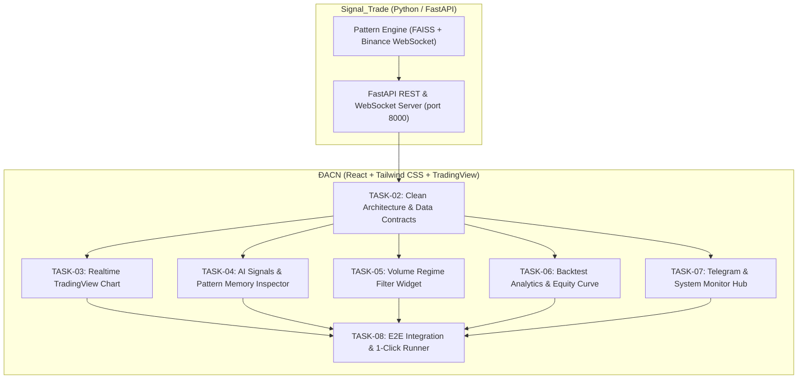

# BẢNG TỔNG QUAN KẾ HOẠCH TÁI CẤU TRÚC DASHBOARD (MASTER ROADMAP)
## DỰ ÁN: NORTHSTAR TRADING INTELLIGENCE - PATTERN AI DASHBOARD

Tài liệu này tổng hợp toàn bộ các nhiệm vụ (tasks) trong lộ trình **tái thiết kế và đập đi xây lại toàn diện Web Dashboard (`ĐACN`)** nhằm đồng bộ 100% với động cơ phát tín hiệu **Binance M5 Pattern-Matching AI (`Signal_Trade`)**.

> [!IMPORTANT]
> **Mục tiêu cốt lõi của đợt cải tiến:**
> 1. **Loại bỏ dữ liệu mô phỏng rác:** Gỡ bỏ các trường và chỉ báo giả lập (MACD, MA20 chung chung, các coin không giao dịch ETH, BNB, các status tự bịa `WATCH`, `EXPIRED`).
> 2. **Đồng bộ hóa 100% trường dữ liệu thực tế từ `Signal_Trade`:**
>    * Vector đặc trưng 49D & Điểm tương đồng Cosine Similarity ($\ge 85\%$).
>    * Tỷ lệ đồng thuận hướng đi (Consensus Ratio $\ge 80\%$) & Số mẫu ký ức khớp ($k \ge 10$).
>    * Bộ lọc phân vị khối lượng Volume Regime ($P_{20} - P_{85}$).
>    * Quản trị rủi ro thực tế: Swing Low/High 15 nến, Buffer Stop Loss, Take Profit, Tỷ lệ R:R ($\ge 1.5$), Quản trị vốn 1%.
> 3. **Kết nối dữ liệu sống (Realtime Live Data):** Dựng Backend API (FastAPI) trong `Signal_Trade` cấp dữ liệu nến Binance thật và tín hiệu AI thật trực tiếp lên TradingView Chart của `ĐACN`.

---

## 1. BẢNG SO SÁNH TRƯỚC VÀ SAU CẢI TIẾN

| Hạng mục | Giao diện cũ (`ĐACN` hiện tại) | Giao diện mới (Sau khi tái cấu trúc) |
| :--- | :--- | :--- |
| **Nguồn dữ liệu** | Mock tĩnh trong file `market.js` (không có backend) | **Live API + WebSocket** từ engine `Signal_Trade` & Binance |
| **Cặp & Khung thời gian** | Nhiều cặp giả lập (BTC, ETH, BNB), nhiều TF (1m, 1h, 1d) | **BTC/USDT M5** (Chuẩn hóa chuyên sâu theo AI Engine, hỗ trợ đổi symbol linh hoạt) |
| **Chỉ báo kỹ thuật** | MACD(12,26,9), MA20 (chung chung, không phản ánh AI) | **49D Normalized Price Curve, RSI(7), Vol Z-Score, ATR Ratio** |
| **Lý do ra tín hiệu** | Đoạn text thủ công cố định | **So khớp mẫu hình FAISS**: Danh sách mẫu hình thắng lịch sử tương đồng, độ tương đồng % |
| **Bộ lọc thị trường** | Không có | **Volume Regime Filter Widget**: Đo trực quan vị thế volume hiện tại trong dải $P_{20} - P_{85}$ |
| **Biểu đồ nến** | Nến ngẫu nhiên, không có marker vào lệnh chuẩn | **TradingView Chart nến Binance thật**, gắn marker BUY/SELL, dóng đường Entry, SL, TP động |
| **Báo cáo hiệu suất** | Số liệu mock tĩnh (Winrate 78% ảo) | **Dữ liệu Backtest Out-of-Sample thật** từ `reports/backtest_trades.csv` & Equity Curve |
| **Giám sát vận hành** | Mock Telegram | **Trạng thái kết nối thực**: Binance Ping, Uptime, Telegram Bot alert test |

---

## 2. DANH SÁCH CÁC TASK CHI TIẾT

| Mã Task | Tên Task | File Chi Tiết | Phụ Thuộc | Trạng Thái |
| :--- | :--- | :--- | :--- | :--- |
| **TASK-01** | Xây dựng Backend API (FastAPI) & Data Bridge | [`task_01_backend_api_fastapi_and_data_bridge.md`](file:///d:/DACNTT-1/ĐACN/plan/task_01_backend_api_fastapi_and_data_bridge.md) | Không | 🔲 Chưa bắt đầu |
| **TASK-02** | Chuẩn hóa Data Contracts & Dọn dẹp Frontend | [`task_02_clean_frontend_architecture_and_data_contracts.md`](file:///d:/DACNTT-1/ĐACN/plan/task_02_clean_frontend_architecture_and_data_contracts.md) | TASK-01 | 🔲 Chưa bắt đầu |
| **TASK-03** | Tái cấu trúc Biểu đồ TradingView M5 (Live Markers & SL/TP Lines) | [`task_03_realtime_tradingview_chart_m5.md`](file:///d:/DACNTT-1/ĐACN/plan/task_03_realtime_tradingview_chart_m5.md) | TASK-01, TASK-02 | 🔲 Chưa bắt đầu |
| **TASK-04** | Trung tâm Tín hiệu AI & Bộ So Khớp Ký Ức (Pattern Inspector) | [`task_04_ai_signals_and_pattern_memory_inspector.md`](file:///d:/DACNTT-1/ĐACN/plan/task_04_ai_signals_and_pattern_memory_inspector.md) | TASK-01, TASK-02 | 🔲 Chưa bắt đầu |
| **TASK-05** | Widget Bộ Lọc Khối Lượng (Volume Regime P20 - P85) | [`task_05_volume_regime_and_market_health_widget.md`](file:///d:/DACNTT-1/ĐACN/plan/task_05_volume_regime_and_market_health_widget.md) | TASK-01, TASK-02 | 🔲 Chưa bắt đầu |
| **TASK-06** | Phân Tích Hiệu Suất Backtest & Biểu Đồ Vốn (Interactive Equity Curve) | [`task_06_backtest_analytics_and_interactive_equity_curve.md`](file:///d:/DACNTT-1/ĐACN/plan/task_06_backtest_analytics_and_interactive_equity_curve.md) | TASK-01, TASK-02 | 🔲 Chưa bắt đầu |
| **TASK-07** | Trung Tâm Giám Sát Vận Hành & Telegram Bot Hub | [`task_07_telegram_bot_monitor_and_system_hub.md`](file:///d:/DACNTT-1/ĐACN/plan/task_07_telegram_bot_monitor_and_system_hub.md) | TASK-01 | 🔲 Chưa bắt đầu |
| **TASK-08** | Tích Hợp Toàn Diện (End-to-End) & Script Khởi Chạy 1-Click | [`task_08_e2e_integration_polish_and_run_scripts.md`](file:///d:/DACNTT-1/ĐACN/plan/task_08_e2e_integration_polish_and_run_scripts.md) | Tất cả các task | 🔲 Chưa bắt đầu |

---

## 3. SƠ ĐỒ LUỒNG PHỤ THUỘC & KIẾN TRÚC TOÀN HỆ THỐNG

---

## 4. QUY TRÌNH THỰC HIỆN VÀ NGHIỆM THU

1. **Tuân thủ tính xác thực:** Không sử dụng bất kỳ số liệu mock ảo nào. Mọi con số trên giao diện đều phải bắt nguồn từ tính toán thực tế của `Signal_Trade` hoặc API Binance.
2. **Quy chuẩn mã nguồn:**
   * Backend: Tuân thủ Pydantic schemas, CORS mở cho localhost, tài liệu hoá Swagger tại `/docs`.
   * Frontend: Giao diện Dark Mode đồng bộ (màu nền Cyberpunk/Fintech `#0D1117`, `#161B22`), dùng `lucide-react` và `lightweight-charts`.
3. **Quy ước trạng thái:**
   * `🔲 Chưa bắt đầu (Pending)`: Chưa được triển khai.
   * `⏳ Đang thực hiện (In Progress)`: Đang được code / unit test.
   * `✅ Hoàn thành (Completed)`: Đã vượt qua kiểm thử và nghiệm thu theo checklist.
